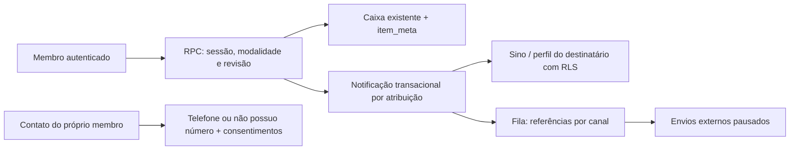

# Demandas: prioridades, responsáveis e avisos — 15/11/2026

## Decisões autorizadas

- Prioridade por item: urgente, alta, normal e baixa. Ordenar caixas pela maior prioridade pendente antes da paginação; itens concluídos não têm precedência. A prioridade é definida por quem organiza a demanda, sem pontuação automática de PDI.
- Membros com permissão de edição podem atribuir demandas da própria modalidade a integrantes autorizados. A seleção usa UUID e nome de exibição; não associa pessoas por nome e não altera permissões do destinatário. Treinamento continua somente consulta nos quadros compartilhados.
- O quadro pessoal continua exclusivo do titular, inclusive frente a administradores. Pode indicar o próprio usuário como responsável, mas não delegar a outro usuário ou notificar sobre texto privado.
- Novas atribuições em quadros de modalidade geram aviso no sino do perfil. A notificação abre a caixa específica sem depender da página em que ela aparece. Notificações e contadores respeitam a autorização atual, página oculta, arquivamento, remoção do item e reatribuição.
- WhatsApp e e-mail **não estão configurados e não fazem envios**. Não foi contratado serviço nem criada chave. A fila guarda apenas referências e mantém `not_configured`; não é permitido registrá-la como enviada.
- Contato solicitado somente na Área Interna. Há opção “Não possuo número”; consentimento para WhatsApp e e-mail é separado e opcional. Telefone restrito ao próprio usuário por RPC; não aparece no diretório de responsáveis nem na notificação de terceiros. Não muda o telefone de autenticação do Supabase e não envia SMS.

## Estrutura

`portal_demand_cards` permanece a única fonte das caixas; os itens `{id,text,done}` não são reescritos pela migração. A nova coluna `item_meta` guarda prioridade e responsável por ID do item. O escritor antigo fica preservado e privado, sendo chamado pelo wrapper para manter validação, revisão e idempotência. Nenhuma coluna/tabela de membros, metas ou PDI é duplicada.

As tabelas técnicas novas são `portal_demand_contacts`, `portal_demand_notifications`, `portal_demand_delivery_outbox` e `portal_demand_features`. Contato e fila não têm SELECT/DML autenticado direto. A caixa de entrada tem RLS sem exceção administrativa para ler notificações alheias. Cada aviso é identificado por caixa/item/destinatário/revisão; repetição da mesma criação não duplica avisos.

O diretório de responsáveis retorna até 500 nomes/UUIDs elegíveis para a modalidade, sem telefone ou e-mail. A lista de caixas tem páginas de 50 por prioridade/UUID; a caixa de entrada tem páginas de 30 por data/UUID. Atualizações concorrentes podem mudar a posição de uma caixa; atualizar o quadro recompõe o recorte.

## Implantação e retorno

1. Validar `20261115_demand_priorities_notifications.sql` em PostgreSQL isolado, incluindo dados antigos, RLS, papéis e rollback.
2. Conferir schema/RLS efetivo do projeto existente antes da execução autorizada. A migração é aditiva e transacional; a solicitação obrigatória de contato começa **desativada**.
3. Publicar o frontend depois da migração. Sem as RPCs novas, os quadros continuam no modo anterior; o contato não bloqueia o Portal antes da instalação.
4. Validar prioridade, atribuição, notificação e preferências com contas de teste e sem enviar mensagens externas. Ativar `contact_required` somente após autorização e validação. Isso pede o contato no próximo acesso interno sem resetar recadastro/PDI.
5. Para retornar: primeiro desativar `contact_required` e restaurar o frontend anterior; depois executar o rollback SQL. Ele preserva dados/contatos/metadados, restaura o escritor antigo e suspende leituras/ações das notificações. Não apaga tabelas, telefones ou cartões. Não alterar migrações antigas.

## Antes de ativar e-mail ou WhatsApp

Será necessária uma implementação de transporte no servidor, após escolher os serviços e autorizar orçamento. Para WhatsApp: número institucional/API oficial, configuração de conta/modelo de mensagem e confirmação do contato. Para e-mail: remetente/domínio verificado e serviço de entrega. As credenciais devem existir somente no servidor, sem `VITE_*` e sem logs de telefone, destinatário completo ou corpo da mensagem.

O transporte deverá reler consentimento, conta, atribuição e modalidade antes de enviar; usar idempotência por evento/canal, limitar volume, tratar falhas, manter webhook autenticado e não reenviar automaticamente a fila histórica `not_configured`. A mensagem externa deve ser mínima (“Você recebeu uma demanda no Portal Tera” + link autenticado), sem copiar descrição privada ou dados de PDI. Troca de telefone exige confirmação nova; o número registrado nesta fase ainda **não foi verificado**.

Não usar automação de WhatsApp Web, QR/sessões pessoais, senha do usuário ou serviços não autorizados como substitutos da API. Referências oficiais: https://developers.facebook.com/documentation/business-messaging/whatsapp/overview e https://whatsappbusiness.com/policy/.

## Verificações

Testes de SQL real isolado cobrem preservação, atribuição por membro, destinatário de modalidade indevida/pendente, consulta sem sessão, dados pessoais privados, CAS, idempotência, paginação por prioridade, marcação como lida, revogação/reatribuição/arquivamento, ausência de envios e rollback. Testes de componentes exercitam bloqueio antes de confirmar o contato, consentimento separado, opção sem número, tratamento de erro, prioridade/responsável e escape de conteúdo. Conferir editor, menu/sino e formulário em 375 px e notebook. Resultados locais não comprovam RLS efetiva de produção ou entrega de mensagens externas.

Validação desta revisão: 233 testes, lint e build passaram na exportação limpa. Em navegador local com fixtures, o Membro A atribuiu uma demanda ao Membro B; B concluiu o contato usando “Não possuo número”, viu o sino com um aviso, abriu a caixa específica, marcou a notificação como lida e acessou as preferências pelo menu do perfil. Editor e notificação conferidos em 375 px; cabeçalho e quadro conferidos em 1366 px. Esses dados fictícios e o adaptador de teste ficaram fora da release e não consultaram produção.

Consulta somente de metadados no Supabase existente em 15/11 confirmou: tabela de cartões e escritor presentes, RLS habilitada, INSERT/UPDATE direto negados a authenticated, colunas necessárias de profiles/portal_user_access presentes e verificação CAS no escritor atual. A tabela de contatos nova ainda estava ausente. Isso demonstra compatibilidade estrutural, não autorização efetiva de produção com sessões dos diferentes papéis. Nenhuma migração/ativação foi executada nessa conferência.

## WhatsApp manual e coleta de contato — 15/11/2026
O primeiro acesso à Área Interna após ativação solicita telefone ou “Não possuo número”. Site público e AVA não mudam. O administrador ativa a flag somente após migration e frontend compatíveis publicados.
Consentimento manual separado (manual_whatsapp_opt_in), opcional, informa expressamente que o editor autorizado verá o número. Não há diretório de telefones. A consulta protegida libera somente o contato do responsável elegível de uma demanda compartilhada pendente, com autorização atual. Consentimento automático antigo não autoriza compartilhamento manual.
O botão confere o contato e exige uma segunda ação para abrir WhatsApp. Revalida sessão/permissões/consentimento na abertura, não guarda telefone em estado, storage ou log. A mensagem inclui apenas aviso genérico e link autenticado, sem descrição privada. O usuário confirma o envio no WhatsApp; o Portal não comprova entrega. Nenhum serviço pago ou envio automático foi ativado.
